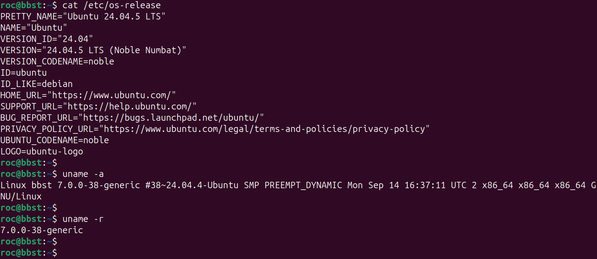
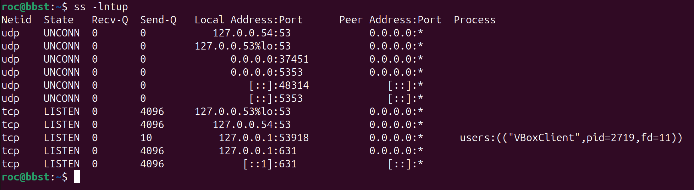
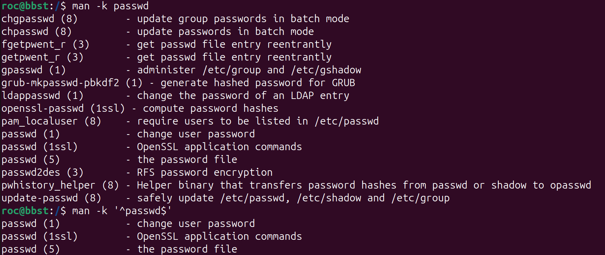

# Kali and Shell Basics

A practical reference for Linux command-line basics used during OSCP preparation and CTF practice. Examples generally work on Kali Linux and Ubuntu unless noted.

## Quick Reference

| Task | Command | Note |
|---|---|---|
| Identify distribution | `cat /etc/os-release` | Distribution and release |
| Check kernel | `uname -r` | Running kernel version |
| Identify current user and groups | `whoami` / `id` | Username, UID, groups |
| Show current directory | `pwd` | Working directory |
| Change directory | `cd /path` | Use an absolute or relative path |
| Return to previous directory | `cd -` | Different from `cd ..` |
| List hidden files and permissions | `ls -la` | Includes dotfiles |
| Identify file type | `file filename` | Does not rely on the extension |
| Read a long file | `less filename` | Search with `/pattern`; quit with `q` |
| Read command manual | `man find` | Quit with `q` |
| Search manual-page descriptions | `man -k passwd` | Search by keyword |
| Check command availability | `command -v nmap` | Checks the current `PATH` |
| Save output | `command > output.txt` | Overwrites the file |
| Append output | `command >> output.txt` | Appends to the file |
| Suppress error messages | `command 2>/dev/null` | Hides standard error |
| Check listening sockets | `ss -lntup` | Process details may require elevated privileges |
| Show interfaces and addresses | `ip a` | Network interface information |
| Show routes | `ip route` | Routing table |
| Search for SUID files | `find / -perm -4000 -type f 2>/dev/null` | A lead to investigate, not proof of a vulnerability |
| Create a gzip-compressed archive | `tar -czf archive.tar.gz directory/` | Creates a `.tar.gz` archive |
| List archive contents | `tar -tzf archive.tar.gz` | Inspect before extracting |
| Extract an archive | `tar -xzf archive.tar.gz -C extracted/` | Ensure destination exists |

## 1. First Commands and System Enumeration

Start by identifying the current environment, account, and basic network configuration. These details help you decide what to investigate next.

### 1.1 Identify the Shell and Working Directory

```bash
echo "$SHELL"
pwd
hostname
```

- `echo "$SHELL"` shows the configured login shell; it may not identify the shell process currently running.
- `pwd` prints the current working directory.
- `hostname` prints the system hostname.

### 1.2 Identify the Operating System and Kernel

```bash
cat /etc/os-release
uname -a
uname -r
```

| Command | Purpose |
|---|---|
| `cat /etc/os-release` | Distribution and release information |
| `uname -a` | Kernel, hostname, architecture, and other system information |
| `uname -r` | Running kernel version |

**Common mistake:** Distribution version and kernel version are different. Check both. A version number alone does not prove that a vulnerability is present; patch level and configuration also matter.



### 1.3 Identify the Current User and Privileges

```bash
whoami
id
```

- `whoami` prints the current username.
- `id` shows the UID, primary GID, and supplementary groups.

Check group membership as well as the username. Groups can affect access to files, devices, and administrative tools.

### 1.4 Check Network Interfaces and Routes

```bash
ip a
ip route
```

| Command | Purpose |
|---|---|
| `ip a` | Network interfaces and IP addresses |
| `ip route` | Routing table and default route |

### 1.5 Check Listening Services

```bash
ss -lntup
```



This lists listening TCP and UDP sockets. Process details may require elevated privileges.

## 2. Help and Manual Pages

Use built-in help and manual pages to resolve unfamiliar syntax and options. Manual pages or their index may be missing on minimal target systems.

### 2.1 Essential Help Commands

```bash
# Open a command manual
man find

# Show help, if supported
find --help

# Search manual-page descriptions
man -k passwd

# Open a specific manual section
man 1 passwd
man 5 passwd
```

| Command | Purpose |
|---|---|
| `man command` | Open the default manual page |
| `command --help` | Display supported options, if available |
| `man -k keyword` | Search manual-page descriptions |
| `man section name` | Open a specific manual section |

### 2.2 Manual Sections to Recognise

A name can appear in more than one manual section because each section describes a different kind of entry. Use a section number when you need a specific entry.

| Section | Content | Example | OSCP / CTF relevance |
|---|---|---|---|
| `1` | User commands and executable programs | `man 1 passwd` | High — command syntax and options |
| `2` | Kernel system calls | `man 2 open` | Medium — low-level program behaviour |
| `3` | Library functions | `man 3 printf` | Medium — program and library behaviour |
| `4` | Special files and device files | `man 4 null` | Low to medium — device details |
| `5` | File formats and configuration files | `man 5 passwd` | High — configuration and file formats |
| `6` | Games and entertainment | `man 6 game-name` | Low — rarely relevant to core OSCP tasks |
| `7` | Miscellaneous topics, conventions, and protocols | `man 7 ip` | Medium — concepts and conventions |
| `8` | System administration commands | `man 8 ip` | High — administration tools |

The examples available depend on the manual pages installed on the system. Section numbers identify the type of entry, not its importance or privilege level.

**Prioritise sections 1, 5, and 8** for common command syntax, configuration formats, and administration tools. Recognise sections 2 and 3 when investigating system calls or library behaviour.

### 2.3 Navigate a Manual Page

| Key | Action |
|---|---|
| `/keyword` | Search forward for a word or pattern |
| `n` | Move to the next match |
| `N` | Move to the previous match |
| `Space` | Move forward one page |
| `b` | Move backward one page |
| `g` | Go to the beginning |
| `G` | Go to the end |
| `q` | Quit |

### 2.4 Practical Example: Finding SUID Files

Use the manual to check the `find` permission syntax:

```bash
man find
```

Inside the manual, type `/-perm`, press `Enter`, then press `n` to find the next match. Press `q` to exit.

```bash
find / -perm -4000 -type f 2>/dev/null
```

| Part | Meaning |
|---|---|
| `/` | Start at the filesystem root |
| `-perm -4000` | Match files with the SUID permission bit set |
| `-type f` | Match regular files |
| `2>/dev/null` | Suppress error messages |

A SUID file is not automatically vulnerable. Review its owner, permissions, behaviour, and configuration before treating it as a possible privilege-escalation path.

**Practical tip:** If the manual is unavailable, try `command --help` where supported. Remember that suppressing errors can also hide useful diagnostic information.



## 3. Package Management

Kali Linux and Ubuntu use APT and DPKG. First check whether a tool is already available; install packages only when needed in your own lab environment.

### 3.1 Check and Search for Tools

```bash
# Check whether a command is available in PATH
command -v nmap

# Check matching package status
dpkg -l | grep nmap

# Search package metadata
apt search nmap
```

- `command -v` checks whether the shell can find a command through the current `PATH`.
- `dpkg -l` shows package status.
- `apt search` searches package metadata.

A command may have been installed outside APT, so command availability and package status are related but not identical checks.

### 3.2 Inspect and Install Packages

```bash
# List files recorded for an installed package
dpkg -L nmap

# Refresh package indexes; does not upgrade installed packages
sudo apt update

# Install a package
sudo apt install nmap
```

**OSCP / CTF tips:**

- Check whether a tool is already available before trying to install it.
- Kali and Ubuntu may provide different versions or repository contents.
- A target may have no internet access or no permission to install packages.
- Avoid unnecessary package upgrades or system changes on a target.

## 4. Filesystem Navigation and Basic File Operations

These commands help you move through a filesystem and inspect or manage files. More advanced searching and text processing belong in the dedicated filesystem/search note.

### 4.1 Absolute and Relative Paths

| Symbol or example | Meaning |
|---|---|
| `/` | Filesystem root |
| `~` | Current user's home directory |
| `.` | Current directory |
| `..` | Parent directory |
| `/etc/passwd` | Example of an absolute path |
| `../file.txt` | Example of a relative path |
| `cd -` | Return to the previous working directory |

```bash
pwd
cd /etc
cd ..
cd ~
cd -
```

**Common mistake:** `cd ..` moves to the parent directory; `cd -` returns to the previous working directory.

### 4.2 List and Identify Files

```bash
ls
ls -l
ls -la
ls -lh
file suspicious.bin
```

| Command | Purpose |
|---|---|
| `ls` | List visible entries |
| `ls -l` | Show permissions, ownership, size, and modification time |
| `ls -la` | Include hidden entries |
| `ls -lh` | Display file sizes in a human-readable format |
| `file filename` | Identify file type from its contents rather than relying on the extension |

Linux filenames are case-sensitive. A file extension is only a naming convention; use `file` when the actual type is uncertain.

### 4.3 View Files and Logs

```bash
cat file.txt
less file.txt
head -n 20 file.txt
tail -n 20 file.txt
tail -f app.log
```

| Command | Use |
|---|---|
| `cat file` | Print a short file |
| `less file` | Read a long file; `/pattern` searches and `q` exits |
| `head -n 20 file` | Show the first 20 lines |
| `tail -n 20 file` | Show the last 20 lines |
| `tail -f file` | Follow newly appended log lines |

**Common mistake:** `cat` prints the whole file. For large logs or configuration files, use `less`, `head`, or `tail`. Log paths vary by distribution; some systems use `journalctl` for system logs.

### 4.4 Create, Copy, Move, and Delete

```bash
# Create a file or update its timestamps
touch file.txt

# Create directories
mkdir work
mkdir -p work/logs

# Copy a file or directory tree
cp source.txt destination.txt
cp -r source_dir/ destination_dir/

# Move or rename
mv old.txt new.txt

# Delete a file or directory
rm file.txt
rmdir empty_dir
rm -r directory/
```

| Command | Purpose |
|---|---|
| `touch file` | Create an empty file if it does not exist; otherwise update timestamps |
| `mkdir -p dir/subdir` | Create a directory and missing parent directories |
| `cp source dest` | Copy a file |
| `cp -r source_dir dest_dir` | Copy a directory tree |
| `mv source dest` | Move or rename |
| `rm file` | Remove a file |
| `rmdir dir` | Remove an empty directory |
| `rm -r dir` | Recursively remove a directory tree |

**Safety reminder:** Check the target path before using `rm -r`. Recursive deletion can remove an entire directory tree. `touch` does not empty an existing file.

## 5. Shell Quoting, Variables, and History

Shell quoting controls how the shell interprets spaces, variables, and special characters. This matters when working with paths, commands, and payloads.

### 5.1 Quotes and Escaping

| Syntax | Meaning | Example |
|---|---|---|
| `'...'` | Prevent variable and command expansion inside the quotes | `echo '$HOME'` |
| `"..."` | Allow variable expansion while preserving most whitespace | `echo "$HOME"` |
| `\` | Escape the next character | `touch file\ name.txt` |
| `$VAR` | Expand a variable | `echo "$PATH"` |
| `$(command)` | Substitute command output | `echo "$(whoami)"` |

Quote paths or variable expansions that may contain spaces:

```bash
file="my report.txt"
cat "$file"
```

### 5.2 Useful Environment and History Commands

```bash
echo "$PATH"
env
history
command -v python3
```

- `PATH` lists directories searched when the shell looks for commands.
- `env` displays environment variables.
- `history` displays command history in the current shell, depending on shell and configuration.
- `command -v` checks whether a command can be found through shell command lookup.

A command not found in `PATH` may still exist elsewhere on the filesystem. Shell behaviour can differ between Bash, Zsh, and other shells.

## 6. Archives and Compression

Archives combine files into one package; compression reduces data size. These are related but different operations.

### 6.1 Common Formats

| Format | Typical command | Notes |
|---|---|---|
| `.tar` | `tar -cf archive.tar directory/` | Archive only; not necessarily compressed |
| `.tar.gz` / `.tgz` | `tar -czf archive.tar.gz directory/` | Tar archive compressed with gzip |
| `.tar.bz2` | `tar -cjf archive.tar.bz2 directory/` | Tar archive compressed with bzip2 |
| `.tar.xz` | `tar -cJf archive.tar.xz directory/` | Tar archive compressed with xz |
| `.zip` | `zip -r archive.zip directory/` | Archive format that supports compression |

### 6.2 Create, List, and Extract Tar Archives

```bash
# Create a gzip-compressed tar archive
tar -czf archive.tar.gz directory/

# List contents without extracting
tar -tzf archive.tar.gz

# Extract into the current directory
tar -xzf archive.tar.gz

# Extract into a specific destination
mkdir -p extracted/
tar -xzf archive.tar.gz -C extracted/
```

| Option | Meaning |
|---|---|
| `c` | Create an archive |
| `x` | Extract an archive |
| `t` | List archive contents |
| `f` | Specify the archive filename |
| `z` | Use gzip compression |
| `j` | Use bzip2 compression |
| `J` | Use xz compression |
| `-C dir` | Change to `dir` before performing the operation |
| `v` | Show filenames processed (verbose output) |

### 6.3 ZIP and Gzip Commands

```bash
# List ZIP contents before extracting
unzip -l archive.zip

# Extract into a chosen directory
unzip archive.zip -d extracted/

# Create a ZIP archive
zip -r archive.zip directory/

# Compress an individual file
gzip file.txt

# Decompress a gzip file
gunzip file.txt.gz
```

`gzip` normally replaces the original file with a compressed `.gz` file. `tar` groups files and directories into an archive; it is often combined with gzip to create `.tar.gz` files.

### 6.4 Safe Extraction Workflow

1. **Identify the format:** use `file archive-name` if the extension is unclear.
2. **List contents first:** use `tar -tzf archive.tar.gz` or `unzip -l archive.zip`.
3. **Choose a destination:** extract unfamiliar archives into a new directory.
4. **Check the result:** use `ls -la extracted/` or `find extracted/ -maxdepth 2 -type f`.

Listing contents does not guarantee an archive is safe. Be careful with unfamiliar files and paths before extraction.

## 7. Terminal Editors

Remember the basic save, search, and exit commands for `nano` and `vim`. Check which editors are installed before relying on one.

### 7.1 Nano

| Shortcut | Action |
|---|---|
| `Ctrl+O` | Save; press `Enter` to confirm the filename |
| `Ctrl+X` | Exit |
| `Ctrl+W` | Search |
| `Ctrl+K` | Cut the current line |
| `Ctrl+U` | Paste the cut text |

### 7.2 Vim

Vim has different modes. Press `Esc` to return to Normal mode before entering commands.

| Action | Command |
|---|---|
| Enter Insert mode | `i` |
| Return to Normal mode | `Esc` |
| Save | `:w` |
| Save and quit | `:wq` |
| Quit without saving | `:q!` |
| Quit if unchanged | `:q` |
| Delete current line | `dd` |
| Undo | `u` |
| Search forward | `/pattern`, then `Enter` |
| Repeat search | `n` |

**Tips:**

- Use `nano` for quick edits when available.
- In Vim, press `Esc` before entering commands such as `:wq` or `:q!`.
- Check availability with `command -v nano vim vi`.
- Verify edits with `cat filename` or `less filename`.

## 8. Common Mistakes

- Linux filenames are case-sensitive.
- The distribution version and running kernel version are different.
- `cd ..` and `cd -` do different things.
- `>` overwrites a file; `>>` appends output.
- `2>/dev/null` hides standard error and may hide useful diagnostic information.
- `apt update` refreshes package indexes; it does not upgrade installed packages.
- A command absent from `PATH` may still exist elsewhere.
- `touch` does not empty an existing file.
- `rm -r` can delete an entire directory tree.
- A SUID file is a lead to investigate, not proof of a vulnerability.
- An archive extension does not guarantee the file's actual format; use `file` when unsure.
- Inspect unfamiliar archives before extracting them.

## Related Notes

- [Quick Reference](Quick-Reference.md)
- [Filesystem, Search and Text Processing](02-Filesystem-Search-and-Text-Processing.md)
- [Pipes, Redirection and Bash](03-Pipes-Redirection-and-Bash.md)
- [Users, Permissions and Privilege Checks](04-Users-Permissions-and-Privilege-Checks.md)
- [Processes, Services and System Inspection](05-Processes-Services-and-System-Inspection.md)
- [Networking and File Transfer](06-Networking-and-File-Transfer.md)
- [Linux Enumeration Checklist](Linux-Enumeration-Checklist.md)
