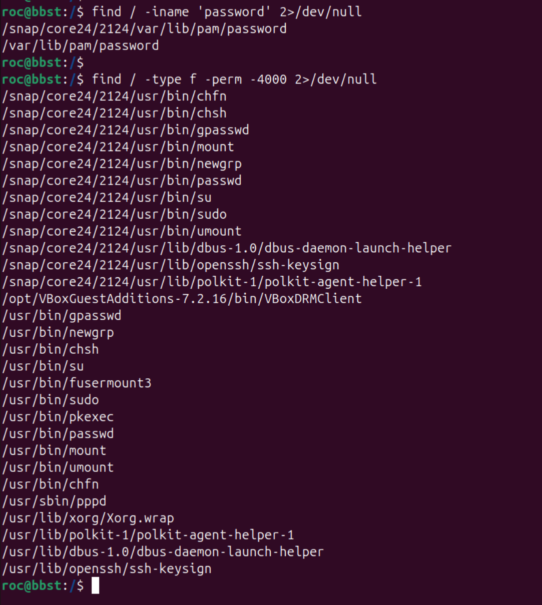

# Filesystem, Search and Text Processing

A practical reference for locating files, searching text, and extracting useful information from Linux command output. Examples generally work on Kali Linux and Ubuntu.

## Quick Reference

| Task | Command | Note |
|---|---|---|
| List hidden files | `ls -la` | Includes dotfiles |
| Identify file type | `file filename` | Checks content, not just extension |
| Find by name | `find /path -name "config.php" 2>/dev/null` | Case-sensitive |
| Find by name, ignoring case | `find /path -iname "config.php" 2>/dev/null` | Case-insensitive |
| Find shell scripts | `find . -type f -iname "*.sh"` | Search current tree |
| Find recently modified files | `find . -type f -mmin -30` | Modified in the last 30 minutes |
| Search text recursively | `grep -Rni "password" /path 2>/dev/null` | Ignore case, show line numbers |
| Extract first colon-separated field | `cut -d: -f1 /etc/passwd` | Common for account data |
| Print selected fields | `awk -F: '{print $1, $7}' /etc/passwd` | Username and shell |
| Show first 20 lines | `head -n 20 file` | |
| Show last 20 lines | `tail -n 20 file` | |
| Count lines | `wc -l file` | |

## 1. Linux Filesystem Structure

### 1.1 Common Directories

| Directory | Purpose |
|---|---|
| `/` | Filesystem root |
| `/home` | Ordinary users' home directories |
| `/root` | Root user's home directory |
| `/etc` | System and application configuration |
| `/tmp` | Temporary files |
| `/var` | Variable data, logs, caches, and application state |
| `/var/log` | Common location for system and application logs |
| `/usr/bin` | Many user commands and executable programs |
| `/usr/sbin` | Many system administration programs |
| `/opt` | Optional or third-party software |
| `/proc` | Virtual filesystem exposing process and kernel information |
| `/dev` | Device files |
| `/mnt`, `/media` | Common mount points |

Directory contents vary between distributions and installations.

### 1.2 File and Directory Listing

```bash
ls
ls -la
ls -lh
file filename
stat filename
```

- `ls -la` includes hidden files and shows permissions and ownership.
- `file` identifies likely file type from content.
- `stat` shows metadata such as permissions, ownership, size, and timestamps.

## 2. Finding Files

### 2.1 `find` by Name and Type

```bash
# Exact case-sensitive name
find /path -name "config.php" 2>/dev/null

# Case-insensitive name
find /path -iname "config.php" 2>/dev/null

# Regular files and directories
find /path -type f 2>/dev/null
find /path -type d 2>/dev/null

# Files by extension
find /path -type f -name "*.conf" 2>/dev/null
find . -type f -iname "*.sh"
```

### 2.2 `find` by Time, Size, and Owner

```bash
# Modified within the last 30 minutes
find /path -type f -mmin -30 2>/dev/null

# Modified within the last day
find /path -type f -mtime -1 2>/dev/null

# Larger than 100 MB
find /path -type f -size +100M 2>/dev/null

# Files owned by a particular user
find /path -type f -user username 2>/dev/null
```

| Option | Meaning |
|---|---|
| `-mmin -30` | Modified less than 30 minutes ago |
| `-mtime -1` | Modified less than one 24-hour period ago |
| `-mtime 2` | Typically 48–72 hours ago |
| `-size +100M` | Larger than 100 MB |
| `-user username` | Owned by the specified user |
| `-type f` / `-type d` | Regular file / directory |

### 2.3 `find` by Permissions

```bash
# SUID files
find / -type f -perm -4000 2>/dev/null

# SGID files
find / -type f -perm -2000 2>/dev/null

# Files with other-write permission
find / -type f -perm -o=w 2>/dev/null

# List matching paths before doing anything destructive
find . -type d -name ".svn" -print
```



`-perm -4000` matches files with the SUID bit set. A special permission bit is a finding to investigate, not proof of a vulnerability.

**Safety reminder:** Do not run destructive `find -exec` commands before reviewing the matched paths. Start with `-print`.

### 2.4 `locate`, `which`, and `command -v`

```bash
locate python3
which python3
command -v python3
```

- `locate` searches a filename database that may be missing or outdated.
- `which` commonly searches the executable path.
- `command -v` is generally preferable for shell-aware command lookup.

**Prerequisites and limitations:**

- `locate` may not be installed by default. On Kali Linux or Ubuntu, install `plocate` if needed:

  ```bash
  sudo apt update
  sudo apt install plocate
  ```

- `locate` searches a prebuilt database rather than scanning the filesystem in real time. If the database is missing or outdated, update it when you have the required privileges:

  ```bash
  sudo updatedb
  ```

- Then search for a file:

  ```bash
  locate filename
  ```

- **OSCP / CTF tip:** The target may not have `plocate` installed, and the database may be outdated. Use `find` as an alternative because it does not depend on a prebuilt locate database.

  ```bash
  find / -iname 'filename' 2>/dev/null
  ```

## 3. Searching Text with `grep`

### 3.1 Common Search Options

```bash
grep "admin" file.txt
grep -i "admin" file.txt
grep -n "admin" file.txt
grep -w "admin" file.txt
grep -v "error" file.txt
grep -Rni "password" /path 2>/dev/null
grep -C 3 "error" file.txt
```

| Option | Meaning |
|---|---|
| `-i` | Ignore case |
| `-n` | Show line numbers |
| `-w` | Match whole words |
| `-v` | Show non-matching lines |
| `-R` | Search recursively |
| `-l` | Show filenames containing matches |
| `-c` | Count matching lines per file |
| `-C 3` | Show three lines before and after a match |
| `-E` | Use extended regular expressions |

### 3.2 Patterns and Regular Expressions

| Pattern | Meaning |
|---|---|
| `^root` | Line begins with `root` |
| `bash$` | Line ends with `bash` |
| `a.*b` | `a`, then any number of characters, then `b` |
| `[0-9]` | One digit |
| `[A-Za-z]` | One ASCII letter |
| `colou?r` with `grep -E` | Matches `color` or `colour` |
| `^(root|kali):` with `grep -E` | Line begins with `root:` or `kali:` |

```bash
grep -n '^root:' /etc/passwd
grep -E '^(root|kali):' /etc/passwd
grep -v '^#' config.conf
grep -E '[0-9]{3}' file.txt
grep -RniE "password|token|secret|api_key" /path 2>/dev/null
```

`grep` uses basic regular expressions by default; `grep -E` enables extended regular expressions. A leading `*` is usually invalid because it has no preceding expression to repeat.

Treat search matches as leads, not proof that a credential is valid or that a vulnerability exists.

## 4. Extracting and Transforming Text

### 4.1 `cut` and `awk`

```bash
# First colon-separated field
cut -d: -f1 /etc/passwd

# Username and login shell
awk -F: '{print $1, $7}' /etc/passwd

# Print the first whitespace-separated field
awk '{print $1}' file.txt
```

`-d:` sets the field delimiter for `cut`; `-F:` does the same for `awk`.

### 4.2 `sed`

```bash
# Print lines 1 through 20
sed -n '1,20p' file.txt

# Replace all occurrences on each line and print to stdout
sed 's/old/new/g' file.txt

# Print lines matching a pattern
sed -n '/error/p' file.txt
```

The examples above print transformed output to the terminal; they do not overwrite the original file.

### 4.3 `sort`, `uniq`, and `wc`

```bash
sort names.txt
sort names.txt | uniq
sort names.txt | uniq -c
wc file.txt
wc -l file.txt
```

`uniq` normally detects adjacent duplicate lines, so `sort` is commonly used first when counting repeated values.

## 5. Practical Search Examples

### 5.1 Search Configuration Files

```bash
find /etc -type f -name "*.conf" 2>/dev/null
grep -RniE "user|host|port|path" /etc 2>/dev/null
```

### 5.2 Search a Relevant Directory for Keywords

```bash
grep -RniE "password|token|secret" /path 2>/dev/null
```

Only inspect files and data within the authorised scope. Treat any discovered secrets as sensitive and avoid copying them into shared notes.

### 5.3 Narrow Broad Searches

Prefer a relevant starting directory over immediately searching `/`. Broad filesystem searches can be slow, noisy, and limited by permissions.

## 6. Common Mistakes

- `find -name` searches filenames; `grep` searches file contents.
- Quote wildcard patterns such as `"*.conf"` so the shell does not expand them before `find` receives them.
- `locate` results may be stale.
- `2>/dev/null` hides errors that could explain missing results.
- `uniq -c` counts adjacent duplicate lines; use `sort` first when appropriate.
- `sed 's/old/new/g' file` prints changed output but does not edit the source file in place.
- `-mtime -2` means roughly the last 48 hours; `-mtime 2` means a different time range.

## Related Notes

- [Kali and Shell Basics](01-Kali-and-Shell-Basics.md)
- [Pipes, Redirection and Bash](03-Pipes-Redirection-and-Bash.md)
- [Users, Permissions and Privilege Checks](04-Users-Permissions-and-Privilege-Checks.md)
- [Linux Enumeration Checklist](Linux-Enumeration-Checklist.md)
